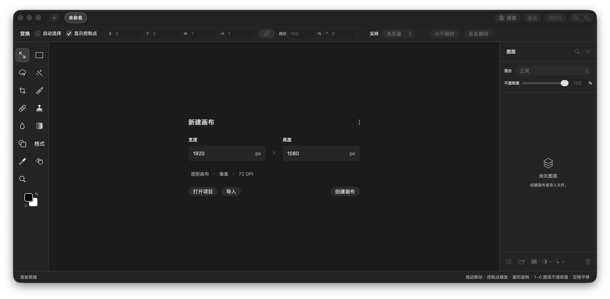
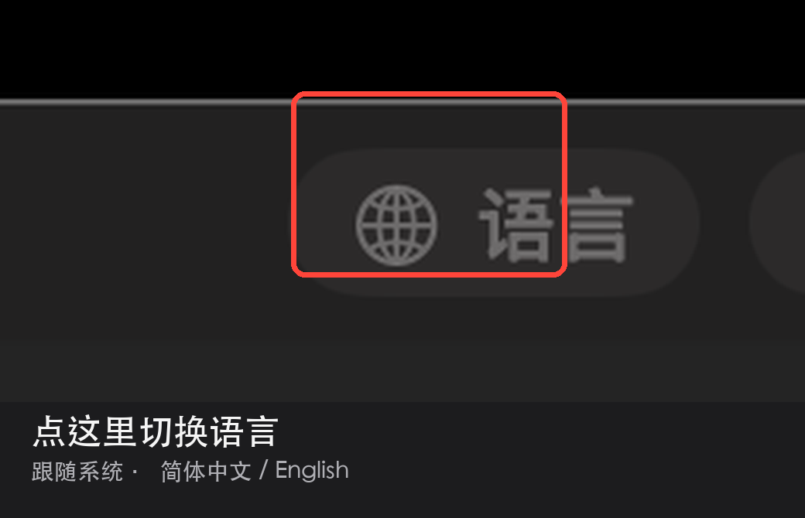

# Compositor 简体中文版

> 非官方简体中文构建，基于 [robbietilton/Compositor](https://github.com/robbietilton/Compositor) 1.5.6。
> 个人自用版本：使用 ad-hoc 签名，未公证，未使用 Developer ID。请勿把它当成官方发布。

Compositor 是一款免费开源的 macOS 图像编辑器，定位为 Photoshop 的替代品。本仓库在上游 1.5.6 的基础上加入完整的简体中文本地化，并在窗口右上角提供语言切换按钮。



## 这个版本有什么

- **简体中文界面**：菜单、工具、图层面板、Camera Raw、导出为、快捷键、命令面板、弹窗、PSD/PDF 导入报告等均已本地化。
- **自动识别系统语言**：默认跟随 macOS 的语言设置。中文系统打开就是中文，英文系统打开就是英文；其他语言回退英文。
- **窗口内语言按钮**：右上角「语言」按钮（地球图标），可在「跟随系统 / 简体中文 / English」之间切换，点「重新启动 Compositor」生效。
- **保留英文模式**：切回 English 后菜单和界面与上游一致，方便对照教程。
- **不改用户数据**：`.comp` 项目、快捷键、混合模式和枚举的持久化值保持原样；界面显示层单独本地化。

## 系统要求

- macOS 26.0 或更高
- Apple Silicon（当前构建为 arm64）
- 从源码构建需要 Xcode 26 或更高

## 安装（DMG）

1. 打开 [Releases](https://github.com/runlinxin-arch/Compositor-chinesebag/releases/latest)，下载 `Compositor-1.5.6-zh-Hans-arm64.dmg`。
2. 打开 DMG，把 `Compositor.app` 拖到「应用程序」。
3. 首次打开如果提示“无法验证开发者”，在 Finder 里右键 `Compositor` → **打开**。

如果系统提示“已损坏”，移除下载隔离标记后再打开：

```bash
xattr -dr com.apple.quarantine /Applications/Compositor.app
```

> 这个包没有 Developer ID 签名，也没有公证。它适合自己用；如果要公开分发给别人，请自己完成签名和公证。

## 从源码构建

1. 克隆仓库，用 Xcode 打开 `Compositor.xcodeproj`。
2. 选择 **Compositor** scheme，按 `⌘R`。
3. 如果没有开发者账号，Xcode 的 Signing 选择 **Sign to Run Locally**；也可以用命令行生成一个本地 ad-hoc Release：

```bash
xcodebuild -project Compositor.xcodeproj -scheme Compositor \
  -configuration Release \
  -destination 'platform=macOS,arch=arm64' \
  -derivedDataPath build \
  CODE_SIGN_STYLE=Manual CODE_SIGN_IDENTITY="-" DEVELOPMENT_TEAM="" \
  PROVISIONING_PROFILE_SPECIFIER="" \
  build
```

产物在：

```text
build/Build/Products/Release/Compositor.app
```

## 切换语言

- 点窗口右上角的「语言」按钮（地球图标）。
- 选择：
  - **跟随系统 · 简体中文**：移除应用级语言覆盖，交给 macOS 决定。
  - **简体中文**：固定中文，不再跟随系统。
  - **English**：固定英文。
- 选完后点 **「重新启动 Compositor」**。如果自动重开被系统拦下，手动打开 app 也会按新语言启动。
- 也可以使用菜单 `Compositor > 设置…`（`⌘,`），内容和语言按钮相同。



## 与上游的差异

这个 fork 只做中文和本地构建相关的改动：

- 新增 `Compositor/Localizable.xcstrings`，`zh-Hans` 共 1196 条键；`scripts/check-localization.py` 审计 0 问题。
- 新增窗口工具栏语言按钮；`AppLanguage` 从系统全局域读取当前语言，用于显示“跟随系统”的实际语言。
- Run scheme 不再强制 `-AppleLanguages (en)`；测试仍强制英文，保证测试稳定。
- 关闭 Sparkle 自动检查，并移除“检查更新”菜单，避免上游英文版覆盖中文构建。
- 为 ad-hoc 签名加入 `disable-library-validation`，让应用能加载上游签名的 `Sparkle.framework`。
- 补上 `Transform` / `Transform Mask` 两个动态 `L()` 调用的漏翻。

上游的完整功能列表见 [上游 README](https://github.com/robbietilton/Compositor#readme)。

## 已知限制

- **未签名/未公证**：只建议本机使用；公开分发前请用 Developer ID 签名并公证。
- **仅 arm64 + macOS 26+**：Intel Mac 和更早的 macOS 用不了当前构建。
- **自动更新已关闭**：上游更新需要手动合并、重新构建。
- **Finder 文档类型名仍是英文**：这是上游在 `Info.plist` 里定义的类型名，`InfoPlist.strings` 无法选择性本地化。
- **系统菜单把 View 显示为“显示”**：这是 macOS 标准菜单的翻译，Photoshop 中文版用的是“视图”；改名需要替换系统菜单。
- **尚未逐屏 QA**：Camera Raw、导出为、快捷键、命令面板、PSD/PDF 报告等主要界面已覆盖，但仍可能有截断或个别英文残留，欢迎提 Issue。

## 汉化进度

- String Catalog：1196 条
- 审计：0 个问题
- 18 条“与英文相同”警告：都是符号、单位或技术词（`Camera Raw…`、`CMYK`、`Esc`、`X`、`Y`、`%` 等）

## 许可证与致谢

本项目基于 [robbietilton/Compositor](https://github.com/robbietilton/Compositor)，原项目使用 MIT 许可证，版权归原作者所有；本仓库是非官方中文分支，不代表上游。

- [上游项目](https://github.com/robbietilton/Compositor)
- [上游 Releases](https://github.com/robbietilton/Compositor/releases)
- [LICENSE](LICENSE)
